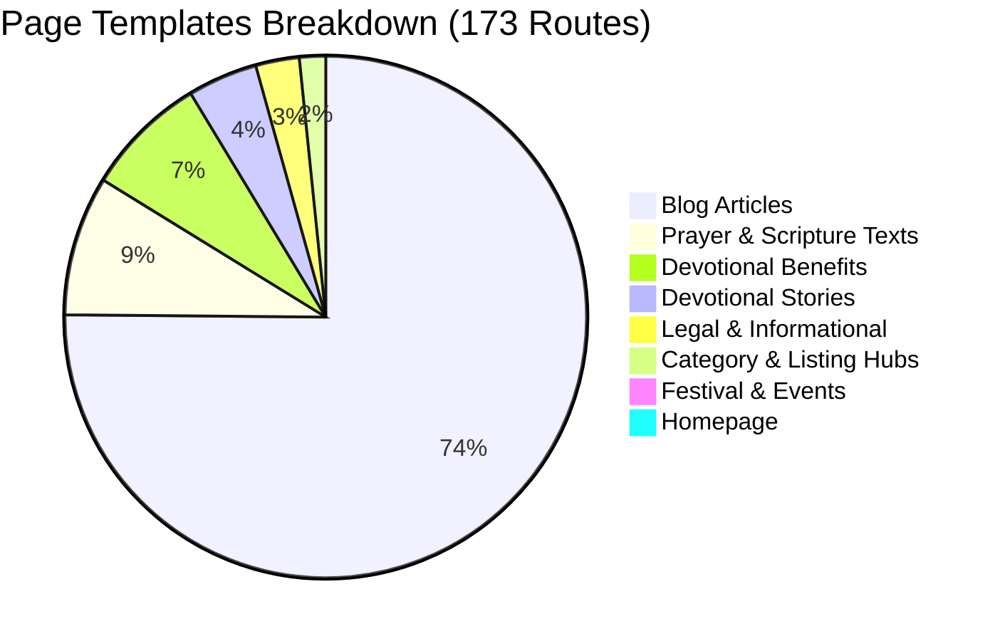

# Technical Architecture & Systems Audit
**Website:** [https://ramhanumanchalisa.com/](https://ramhanumanchalisa.com/)  
**Stage:** Stage 1 — Discovery & Baseline Audit  
**Date:** 2026-11-10  
**Branch:** `admin-pagebuilder`  

---

## 1. Hosting, Deployment & Runtime Stack

| Layer | Technology & Configuration |
| :--- | :--- |
| **Framework** | **Astro 5.2.0** (`output: 'server'`), `@astrojs/react` 4.2.0, React 19.2.8 |
| **Hosting & Edge Adapter** | **Cloudflare Pages** via `@astrojs/cloudflare` 12.0.0 (image service: `passthrough`) |
| **Database & ORM** | **Cloudflare D1** (`jaishreeram-db`, ID: `0143ff7e-7afc-4654-910b-21315a64940b`) with **Prisma ORM 5.22.0** (`@prisma/adapter-d1`) |
| **Build Pipeline** | `npm run build` &rarr; `prisma generate && astro build` &rarr; Output directory `dist/` |
| **Runtime Environment** | Node.js 20+ compatibility (`compatibility_date = "2026-08-25"`, `compatibility_flags = ["nodejs_compat"]`) |
| **Styling & Design Tokens** | Tailwind CSS v4 with custom devotional design tokens (`--color-warm-cream`, `--color-saffron`, `--color-gold-subtle`, `--color-dark-brown`) |
| **Redirects Engine** | 23 status 301 permanent redirects configured in `astro.config.mjs` |

---

## 2. Current Admin Architecture

### 2.1 Access & Authentication
- **Path:** `/admin` (Protected)
- **Login Mechanism:** Google OAuth 2.0 (`/api/auth/signin` &rarr; `https://oauth2.googleapis.com/token` &rarr; `/api/auth/callback`).
- **Authorization Check:** Strictly locked to authorized owner email (`ashishkushwaha88643@gmail.com`). Sets HttpOnly `admin_session` cookie valid for 24 hours.
- **Admin Sub-pages:**
  - `/admin/index`: Overview dashboard (recitation counter, posts count, benefits count, track counts).
  - `/admin/blog`: Create, edit, and publish blog articles.
  - `/admin/benefits`: Manage devotional benefits items.
  - `/admin/faqs`: Manage global and page-specific FAQ schemas.
  - `/admin/audio`: Manage audio tracks, reciters, and synchronization timestamps.
  - `/admin/languages`: Regional language translation mappings.
  - `/admin/jayanti`: Hanuman Jayanti date and tithi config.
  - `/admin/layout`: Sidebar gadget toggles, header notice, and ad slot settings.
  - `/admin/stories`: Web stories management dashboard.

### 2.2 Content Storage & Propagation to Production
- **Dual-Storage Model:**
  1. **Primary Live Edge:** Cloudflare D1 SQL database (`Post`, `Benefit`, `Faq`, `JayantiConfig`, `AudioTrack`, `RecitationCounter`, `Subscriber`, `SiteLayoutConfig`).
  2. **Static Fallback:** Local repository files (`src/data/blog.ts`, `src/data/benefits.ts`, `src/data/stories.ts`, `src/data/scriptures/*.json`).
- **Live Publishing Flow:** In the current setup, saving via Admin API updates D1 directly. SSR pages render dynamically from D1. However, pages outside blog/benefits/faqs (such as `/sankat-mochan-hanumanashtak`, `/hanuman-jayanti`, `/bajrang-baan`) are **hardcoded in `.astro` files** and cannot currently be customized by the admin without developer code changes.

---

## 3. Site Inventory & Template Classification

The site comprises **173 total discoverable routes** categorized into 7 core templates:

### Template 1: Homepage (1 Route)
- **Route:** `/`
- **Current Component Sections:**
  1. `HeaderNavigation`: Multi-level desktop dropdowns & mobile drawer (shared).
  2. `HeroSection`: Full-width Lord Hanuman cinematic poster with Abhaya mudra, flush under navbar (unique).
  3. `StoryHighlights`: Circular Instagram-style story highlights carousel (shared).
  4. `ChalisaTemplate`: Complete 40 Chaupais Awadhi recitation with synchronized audio and language switchers (shared).
  5. `DiyaCounter`: Interactive Diya lighting japa tracker (shared).
  6. `CategoryDiscovery`: Visual grid linking to all 6 deity collections (shared).
  7. `PopularCollections`: Curated sacred hymns and collections (shared).
  8. `Sacred Stotras Hub`: Cards for Ram Chalisa, Bajrang Baan, Hanumanashtak, and Aarti (unique).
  9. `InstagramShowcase`: Official `@ramhanumanchalisadotcom` highlight and follow card (shared).
  10. `Devotional Study Guide`: Background and significance essay (unique).
  11. `PageFaqs`: Dynamic FAQ accordion with FAQPage JSON-LD schema (shared).
  12. `SubscriptionGadget`: Morning blessings newsletter form (shared).
  13. `FooterSection`: Multi-column devotional footer (shared).

### Template 2: Prayer & Scripture Text (16 Routes)
- **Routes:**
  - Hardcoded (10): `/sankat-mochan-hanumanashtak`, `/bajrang-baan`, `/ram-chalisa`, `/hanuman-aarti`, `/hanuman-stuti`, `/hanuman-chalisa-meaning`, `/shri-hanuman-chalisa-path-vidhi`, `/ram-hanuman-chalisa`, `/hanuman-chalisa-audio-mp3`, `/hanuman-chalisa-pdf`.
  - Regional Languages (6): `/hanuman-chalisa/en`, `/hanuman-chalisa/te`, `/hanuman-chalisa/bn`, `/hanuman-chalisa/kn`, `/hanuman-chalisa/gu`, `/hanuman-chalisa/mr`.
- **Shared Components:** `BreadcrumbNav`, `PageFaqs`, `HeaderNavigation`, `FooterSection`, `AdSlot`.
- **Unique Components:** Scripture clients (`HanumanashtakClient`, `AartiClient`, audio synchronizers, PDF generator sheets).
- **Hard Rule Requirement:** All scripture verses are sacred and **MUST BE LOCKED** against accidental edits.

### Template 3: Festival & Event (1 Route)
- **Route:** `/hanuman-jayanti`
- **Sections:** Breadcrumbs, Event Title Badge, Upcoming Date & Tithi Timings Card, Significance & Legends, Step-by-Step Puja Vidhi, FAQs, Event Schema.

### Template 4: Blog Articles (139 Routes)
- **Routes:** `/blog/[slug]`
- **Sections:** Breadcrumbs, Article Metadata Header, Featured Media, ArticleShareBar (sticky reading progress & WhatsApp share), Body content, Author Box, Prev/Next Navigation, Dynamic FAQs.

### Template 5: Benefits & Sadhana Slugs (14 Routes)
- **Routes:** `/hanuman-chalisa-benefits/[slug]`
- **Sections:** Breadcrumbs, Benefit Hero, Detailed Spiritual Analysis, Chaupai Connection, Practical Chanting Recommendations, Related Benefits.

### Template 6: Devotional Stories (8 Routes)
- **Routes:** `/stories/[slug]`
- **Sections:** Vertical 9:16 interactive StoryViewer, Slide Navigation, Awadhi Verses, Hindi/English Meanings, 1-Tap WhatsApp Share, Related Scripture CTA.

### Template 7: Category & Legal (8 Routes)
- **Category Listing Hubs (3):** `/blog`, `/hanuman-chalisa-benefits`, `/stories`
- **Informational & Legal (5):** `/about`, `/contact`, `/faq`, `/privacy-policy`, `/disclaimer`

---

## 4. Technical, SEO & Operational Risk Analysis

| Risk Category | Potential Danger | Mandatory Mitigation Strategy |
| :--- | :--- | :--- |
| **SEO & URL Protection** | Altering a slug, canonical, or title damages Google search indexing. | Every page entry in the block system keys strictly by its **read-only canonical slug**. Build validation fails immediately if any URL or canonical changes. |
| **Scripture Text Corruption** | Accidental misspelling or reformatting of Awadhi/Sanskrit verses. | Scripture blocks are defined as `LOCKED`. Editing requires an explicit `scripture_editor` role with a permanent religious authenticity warning. |
| **AdSense & CLS** | Moving ads into illegal placements or causing Cumulative Layout Shift. | Ad slots (`ca-pub-2458897753508445`) are restricted to predefined system slots (`aboveFold`, `inContent`, `footer`). Dimensions are reserved with CSS aspect-ratio. |
| **Social & Embed Safety** | Arbitrary script injections or broken third-party widgets. | Social blocks (Instagram, YouTube, WhatsApp) strictly use sanitized, allow-listed iframes and static cards. Zero scraping and zero arbitrary `<script>` tags. |
| **Build & Edge Performance** | Complex CMS models slowing down Cloudflare Pages build times. | Pure static schema-validated JSON storage (`src/data/pagebuilder/pages/*.json`). Zero external runtime database calls required during production static generation. |
